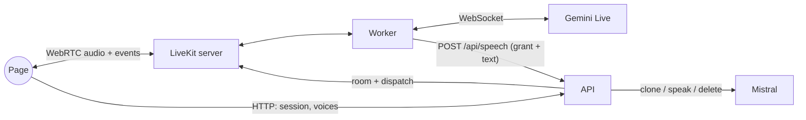
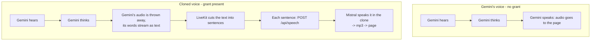

# Architecture

## The pieces

| Piece | Job | Holds which secrets |
|---|---|---|
| **Page** (`web/`) | Captures the microphone, plays the worker's voice, shows the conversation and tool calls, records and uploads voice samples | none (a short-lived LiveKit token per call) |
| **LiveKit server** | Carries audio and small events between the page and the worker. Knows nothing about Gemini or Mistral | its own API key and secret |
| **Worker** (`worker/`) | Joins the call's room, talks to Gemini Live over a WebSocket, runs the tools, has the cloned voice speak | Google key |
| **Gemini Live** | Hears the user, decides turns, thinks, asks for tool calls, and (optionally) speaks | n/a |
| **API** (`api/`) | Serves the page, starts calls, keeps the cloned-voice library and the encrypted recordings, speaks in the clone, runs the nightly care | Mistral key, master key, LiveKit secret |
| **Mistral** | Clones a voice from a recording; speaks text in it (Voxtral TTS) | n/a |

LiveKit moves the media. The worker holds the call's logic. The API holds everything that needs a secret.

## Who talks to whom

- Page to LiveKit: **WebRTC** (the connection is set up over a WebSocket, then audio moves over WebRTC).
- Worker to Gemini: **WebSocket**, open for the whole call, audio and text both ways.
- Everything else is ordinary **HTTP**.
- The page and the worker are both participants in one LiveKit **room** (one room per call). There is no direct
  page-to-worker link.

## Starting a call

1. The page calls `POST /api/session {language, use_clone}`.
2. The API ends any older call (one call at a time), makes a room named `demo-<call id>`, and signs a **join token**
   for that room only: microphone publishing only, 10 minutes to join, a random identity (it names nobody).
3. If the page's switch is on **and** a cloned voice is active **and Mistral still has it** (checked now), the API also
   signs a **speech grant** for this call. If the voice is lost or Mistral cannot be reached, there is no grant and
   Gemini speaks from the start.
4. The API **dispatches** the worker to the room with a small message: call id, language, the caller's identity, and the
   grant if there is one. Only the API can dispatch (it holds the LiveKit secret), so the worker trusts that message.
5. The page joins the room and publishes the microphone. The worker joins, waits for that caller, builds the Gemini
   session, and greets.

A room nobody joins closes after 2 minutes; one everybody left closes after 30 seconds; a call ends at 30 minutes.

## Who speaks: the two modes

The muted-Gemini trick (`text_only` and `text_only_session` in `worker/agent.py`): while Gemini's
session announces a reply, the worker re-announces it as **text-only** and drains the audio. LiveKit then speaks that
text with the call's TTS, and keeps its own turn-taking, interruptions and transcript. Because the cloned voice answers
a whole text at once, it is wrapped so each sentence is fetched while the one before it plays.

**When the clone fails, Gemini's own voice takes over**, so a call is never left silent:

1. **Before the call:** the API checks the active voice at Mistral (`library.verified_voice_id`). If Mistral has lost it,
   or cannot be reached, no grant is issued and Gemini speaks from the start (a lost voice is made again in the
   background).
2. **During the call:** if a sentence cannot be spoken, the worker switches the call's `VoiceMode` to Gemini
   (`VoiceFallback` in `worker/agent.py`). From the next message Gemini's audio is played as it is instead of being
   thrown away, Gemini is asked to say the reply that was never heard again, and the page gets a `voice.fallback` event.
   The switch lasts for the rest of the call.

Limits: the first failed reply is silent until Gemini repeats it, the repeat restarts that answer from the beginning, and
LiveKit may retry a failing sentence before giving up, so the switch can come after the first failure. This path is
unit-tested with fakes but was never run against a real LiveKit call.

## The prompt

`worker/prompts.py` is the voice prompt of Mira, CareVoice's medical assistant: she knows nothing on her own, gets everything from her tools, never diagnoses, puts an emergency first, keeps every fact a tool gives and adds none, never promises a lookup she cannot do, never mentions tools, follows the language rule, hangs up on goodbye and stops when interrupted.

## The tools

`worker/tools.py`. Plain Python, hardcoded data, run inside the worker.

| Tool | Does |
|---|---|
| `rag_answer(question)` | looks for a keyword (about Mira, appointment, hours, prescription, contact; in English, French, Dutch or German) and returns a fixed snippet, or "nothing found" |
| `history(count)` | the last N turns of this call (default 5), from the worker's own transcript |
| `medical_info(topic)` | canned, conservative health information (fever, headache, cough, sprain, dehydration, sore throat), always with a not-medical-advice line; anything that could be an emergency (chest pain, cannot breathe, ...) answers with the emergency number first |
| `get_time()` | the current date and time |
| `find_appointment_slots(specialty)` | free slots for a specialty (demo data; it cannot book) |
| `end_call()` | (not one of the five tools) Gemini says goodbye, then the worker closes the room |
| `stop_speaking()` | (cloned calls only) Gemini cuts off its own reply |

Every call is sent to the page as a `tool.called` event, so the Tool calls panel shows it.

## Events from the worker to the page

On the LiveKit data topic `demo.voice_events`, JSON:

| `type` | Fields | Meaning |
|---|---|---|
| `transcription.segment` | `id`, `role` (user/assistant), `content`, `final`, `interrupted` | words, updated until `final` |
| `agent.state.changed` | `old_state`, `state` | listening / thinking / speaking: drives the orb |
| `tool.called` | `name`, `arguments`, `answer` | a tool ran |
| `call.ended` | `reason` | Gemini hung up after a goodbye |
| `voice.fallback` | `to` | the cloned voice failed; Gemini speaks with its own voice from now on |
| `error` | `source`, `code`, `message`, `fatal` | the kind of error only, never its text (it could carry a key) |

## Data

SQLite, two tables (`api/db.py`):

- `voice_clones`: id, label, language, `mistral_voice_id`, status (`pending`, `ready`, `deleting`, `gone`), `active`,
  `retention_days`, and the consent (`speaker_name`, `consented_at`, `consent_wording`, `source`, `reading_check`).
  A unique index allows **one active clone per language**.
- `voice_recordings`: the encrypted recording (`ciphertext`, `nonce`, `wrapped_key`, `filename`), one per clone,
  deleted with it.

Nothing else is stored. A call lives in memory only (`api/calls.py`), and ends with the API's restart.

## Which clone speaks a call

`library.active_voice_id(language)` picks it, in this order (a call is then only promised that voice after
`library.verified_voice_id` has checked it at Mistral):

1. the active clone made for exactly the call's language (e.g. `be-nl` for `be-nl`);
2. an active clone of the same base language (a `nl-nl` call is served by a `be-nl` clone);
3. the active clone that has existed the longest;
4. none: Gemini's own voice.

Only `ready` clones count. The page's language list is `en`, `nl`, `fr`, `de`, so in the demo the exact and base
languages are the same code.

## HTTP API

| Method and path | Body | Answer |
|---|---|---|
| `GET /api/health` | | `{ok: true}` |
| `GET /api/config` | | languages, `consent_wording`, `cloning` (is a Mistral key set) |
| `GET /api/clones` | | the clones (never the provider's voice id) |
| `POST /api/clones` | multipart: `label`, `language`, `speaker_name`, `consent`, `source`, `reading_check`, `sample` (mp3/wav, 15 MB max) | the new clone. 400 no consent / wrong type, 413 too big, 502 the voice service failed |
| `POST /api/clones/{id}/activate` | | the clone speaks its language; the one that did stops |
| `POST /api/clones/{id}/deactivate` | | it stops speaking |
| `GET /api/clones/{id}/check` | | `{works: bool}`; a voice Mistral lost is marked `gone` |
| `DELETE /api/clones/{id}` | | deleted at Mistral first, then here. 502 if Mistral could not: kept as `deleting`, retried |
| `POST /api/session` | `{language, use_clone}` | `{session_id, server_url, participant_token, company_voice}` |
| `POST /api/session/end` | `{session_id}` | closes the room. 404 if there is no such call |
| `POST /api/livekit-webhook` | LiveKit's signed event | ends the call when its room finishes. 401 if not signed |
| `POST /api/speech` | `{grant, text}` | mp3. 403 bad grant, 400 nothing to read, 404 no clone speaking. Called by the worker |

## Settings

All in `.env` (see `.env.example` for every one, with comments). The ones that matter:

| Setting | Read by | Meaning |
|---|---|---|
| `GOOGLE_API_KEY` | worker | Gemini |
| `GEMINI_LIVE_MODEL`, `GEMINI_LIVE_VOICE` | worker | default `gemini-3.8-live`, `Kore` |
| `MISTRAL_API_KEY`, `TTS_API_BASE`, `TTS_MODEL` | api | cloning and speech |
| `TTS_CLONE_EXPRESSIVENESS`, `TTS_CLONE_PACE` | api | how a clone sounds |
| `VOICE_MASTER_KEYS` | api | the vault's master key(s) |
| `DEMO_SECRET` | api | signs speech grants (falls back to the LiveKit secret) |
| `LIVEKIT_*` | api, worker | the server's address and key |
| `DEMO_API_URL` | worker | where the worker asks for speech |
| `VOICE_CARE_AT`, `VOICE_CARE_TIMEZONE` | api | the nightly care |
