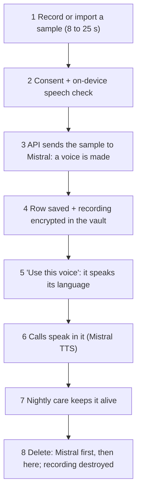

# What happens to a cloned voice

From the moment someone speaks into the microphone to the day the voice is deleted.



## 1. The sample

- **Record:** the browser records compressed audio; it is converted to a plain mono **WAV** in the browser (every voice
  cloner reads it) before it is sent. Recording runs 8 to 25 seconds and stops itself at 25.
- **Import:** an **mp3 or wav** file, up to 15 MB. Other types are refused.
- A clone copies the *delivery* of its recording: a flat recording gives a flat voice. Record in a quiet room, at a
  natural pace.

## 2. Consent

Nothing is made without it. The speaker's **name** and a **ticked consent** are required, and both are stored with the
voice: who, when, which wording (`demo-v1`) and how the sentence was checked.

For a recording, the speaker reads a shown sentence aloud. The check that they did runs **on the device only**: the
browser's on-device speech recognition, never a cloud service. A browser that cannot promise that is never asked to
recognise speech, and shows a manual tick ("I read the sentence above aloud") instead. The result is stored as
`heard` or `ticked`.

Consent is withdrawn by **deleting the voice**.

## 3. The clone at Mistral

`api/library.py: add`. The API:

1. makes the row first (status `pending`), so the voice at Mistral is named after it: `voicedemo:<clone id>`;
2. stores the recording in the vault;
3. sends the sample to Mistral with the voice's **base language** (`nl-be` is sent as `nl`) and a retention of 365 days;
4. saves Mistral's voice id and sets the row `ready`.

If Mistral refuses, the row and the recording are removed: a refused voice leaves nothing behind. If no master key is
set, no voice is made (nothing could be kept).

## 4. The vault

`api/vault.py`. Every recording is encrypted with **AES-256-GCM under a key of its own**. That key is stored next to
it, **locked by a master key** from `VOICE_MASTER_KEYS`, which is not in the database. Both are bound to the clone they
belong to: a recording copied onto another clone does not open, and a changed recording is refused.

Why keep the recording at all? So a voice Mistral loses can be made again (step 7).

`LocalKeyService` reads the master keys from the environment. It is the seam for a real key service (an EU KMS or
Vault): replace `key_service()` with an adapter and nothing else changes. **That adapter does not exist here.**

### Master key

```powershell
python -m api.make_master_key .env           # first key; never printed; refuses if one exists
python -m api.make_master_key .env --rotate  # a new key goes first; the old ones stay
python -m api.care                           # lock every recording with the newest key
```

After a rotation and a care run, the old entry can be removed from `VOICE_MASTER_KEYS`. **A key must be kept at least as
long as any recording it locks.** Never share one key between environments.

## 5. Using it

A clone speaks only when it is **active**. Several languages can have an active clone at once, but only **one per
language** (the database enforces it); activating a clone stops the one that spoke its language.

Which clone a call gets is described in `architecture.md` ("Which clone speaks a call").

## 6. Speaking

For each sentence, the worker sends `{grant, text}` to `POST /api/speech`. The API:

- checks the grant belongs to a live call;
- turns the text into plain speech (no Markdown, links, citations or code);
- asks Mistral to speak it with the clone's voice id, as **mp3**, with the chosen **pace tag** and **expressiveness**
  (`TTS_CLONE_PACE`, `TTS_CLONE_EXPRESSIVENESS`);
- logs **which clone spoke, under which consent version, how many characters**. Never the words.

If Mistral answers that the voice does not exist (404), the clone is marked `gone` and the voice is **made again in the
background** from the kept recording. The call does not go silent: the worker switches that call to **Gemini's own
voice** and Gemini says the reply again (see `architecture.md`, "Who speaks: the two modes"). A call that starts while
the voice is lost never gets a grant: the API checks the voice at Mistral first.

## 7. The nightly care

`api/care.py`, once a night (`VOICE_CARE_AT`, default 00:00, in `VOICE_CARE_TIMEZONE`, default Europe/Brussels), or by
hand with `python -m api.care`:

1. looks up every `ready` voice at Mistral and **makes lost ones again** from their kept recording;
2. **retries deletes** Mistral could not do;
3. tells Mistral again to keep every voice **365 days** (its longest), so to the user a voice lasts until it is deleted;
4. **locks recordings with the newest master key** after a rotation.

The loop runs inside the API process. If the API is stopped at midnight, that night's care is skipped; run
`python -m api.care` to catch up.

## 8. Deleting

`DELETE /api/clones/{id}`:

1. the row is marked `deleting` (never spoken, no longer active);
2. the voice is deleted **at Mistral first**; a voice Mistral does not have counts as already gone;
3. only then is the row deleted, and the recording goes with it (`ON DELETE CASCADE`).

If Mistral cannot be reached, the row stays as `deleting` and the care retries it, so **no voice is ever left at Mistral
that the demo has forgotten**.

## Backups

A deleted recording is gone from the database at once, but **not from copies of the database made before**. If you back
up `data/demo.sqlite3` (or the Docker volume `demo-data`), those copies still hold the encrypted recording until they
expire. The consent text promises "from any backup within 30 days": keep backups no longer than that, and keep a master
key at least as long as the backups it locks.

## Not done

- A real key service (the master key is read from the environment file).
- A separate "withdraw consent" action (deleting the voice is the withdrawal).
- A mid-call voice change; cross-language quality was never tested on a live call.
